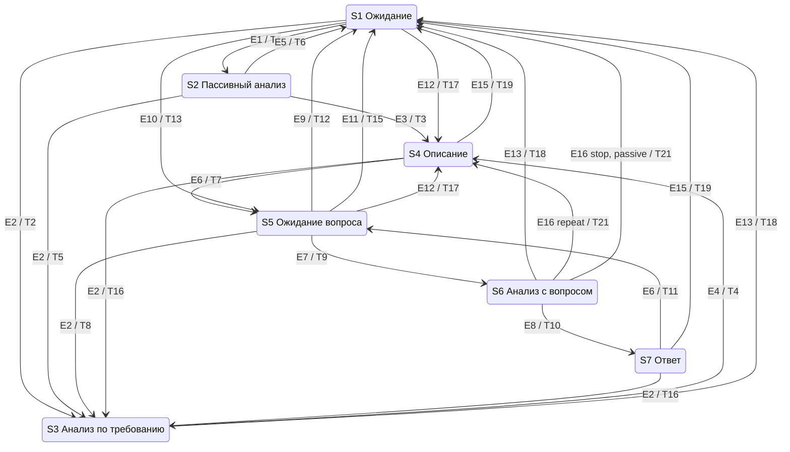
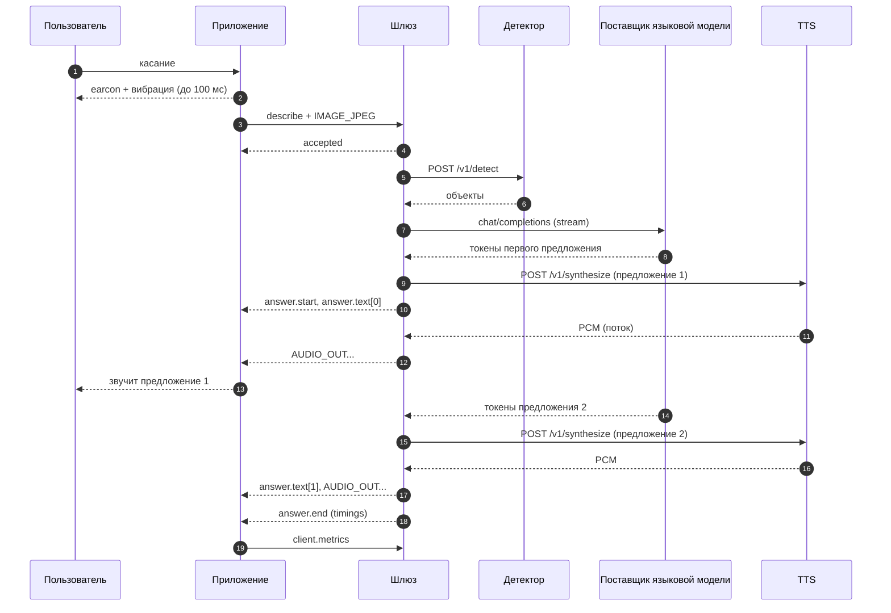

# assistant-low-vision-mobile: спецификация

Выдержка из общей спецификации задачи `001-voice-scene-assistant` «Система голосового описания сцены для людей с нарушениями зрения: экспериментальный прототип». Источник - `docs/specs/001-voice-scene-assistant/spec.md` общего проекта: каталога, в котором рядом лежат `assistant-low-vision-platform`, `objects-detector`, `asr-service`, `tts-service` и `assistant-low-vision-mobile`. Вручную файл не правится: изменения вносятся в общую спецификацию и переносятся сюда.

Состав выдержки:
- общие разделы - без изменений, это общий контракт всех репозиториев: «Контекст и цели», «Глоссарий», «Сценарии использования», разделы требований 1-5 (SYS, NFR, CON, KM, PROTO) и «Принятые решения»;
- разделы требований этого репозитория: 13 (MOB) и из раздела 15 (EXP) - EXP-6, EXP-7;
- критерии приёмки этого репозитория по таблице «Затрагиваемые модули» общей спецификации: AC-2, AC-88 - AC-103, AC-124 - AC-126, AC-138 - AC-144.

Команды критериев выполняются из корня этого репозитория: префикс `cd assistant-low-vision-mobile &&` убран, пути внутри репозитория записаны от его корня, а соседние репозитории общего проекта - как `../<репозиторий>/`. Сквозные критерии (AC-2 и AC-126) перенесены своей частью команды. Требования и критерии других модулей, на которые ссылается текст, - в общей спецификации.

Ключевые слова требований: **должен** - обязательно, проверяется критерием; **следует** - желательно, отказ обосновывается в `plan.md`; **может** - по желанию, критериев нет.

## Контекст и цели

- Зачем:
  - магистерская диссертация «Интеллектуальная система распознавания образов с голосовым сопровождением для людей с нарушениями зрения» (ГУАП, 09.04.01, группа 4542мк);
  - противоречие: точное описание сцены требует мощных моделей, которые увеличивают время ответа, а быстрые модели снижают качество описания;
  - проблема: неизвестно, какое сочетание и размещение моделей даёт голосовой ответ за приемлемое время без потери точности;
  - гипотеза, которую проверяет прототип: распределённое размещение сервисов и подбор моделей позволяют формировать голосовое описание сцены не более чем за 2000 мс (95-й перцентиль времени «касание → звук») при доле верно названных ключевых объектов не менее 75 % (объект засчитан, только если верно названы его класс и направление); при этом доля ответов, упрощённых из-за таймаута или отказа языковой модели (откатов на шаблон), не превышает 10 %, иначе время достигнуто за счёт отказа от модели. Гипотеза подтверждена, только если выполнены все три условия (EXP-8);
  - источники требований: `diploma/works/4542мк(НИР)КарповНИ.docx` (прецедент, концептуальная модель, архитектура), `diploma/works/КарповНИ(Содержание)4542мк.docx` (гипотеза, модели-кандидаты, метрики, методика), `diploma/works/4542мк(ЛР)КарповНИ-Задания.docx` (лабораторные 1-6), диаграммы `diploma/works/*.drawio`, решения автора от 2026-10-25 (раздел «Принятые решения»).
- Результат - открытый (Apache-2.0) экспериментальный прототип, который одновременно служит стендом для замеров:
  - мобильное приложение для Android, которым незрячий человек пользуется без опоры на зрение: касание - описание сцены, удержание - вопрос голосом, двойное касание - повтор, пассивный режим с предупреждением об опасности;
  - Шлюз на Go - единая точка входа: потоковый конвейер «снимок или вопрос → модели → голос», описание сцены, история диалога, журнал времени каждого этапа, конфигурация стенда;
  - сервисы ИИ-моделей с единым интерфейсом на Python: обнаружение объектов, распознавание речи, синтез речи - только в своём размещении;
  - языковая модель - облачный поставщик по OpenAI-совместимому API: Qwen через Polza.ai напрямую, GigaChat через прокси gpt2giga; своего сервера языковой модели нет;
  - развёртывание в двух вариантах: распределённый (эталонный) - облачная VM с доменом и своя машина моделей с видеокартой за NAT, связанные туннелем WireGuard, и вариант «всё своё на машине моделей», где VM - только TLS-прокси; защищённое соединение с приложением по домену с сертификатом Let's Encrypt;
  - инструменты эксперимента: задержка по этапам (медиана и 95-й перцентиль), доля верно названных ключевых объектов, повторные прогоны по набору данных для каждой конфигурации моделей с разбросом между прогонами, аналитическая оценка варианта «всё на устройстве».
- Граница задачи: эта задача даёт систему, экспериментальный стенд и инструменты эксперимента. Проведение эксперимента на наборе EXP-1, сравнение моделей и размещений и вердикт по гипотезе - задача `002-hypothesis-experiment`; она начинается после закрытия этой задачи и сбора набора (решение автора 2026-10-26).
- Главный принцип - скорость. Каждое решение оценивается по вкладу во время «касание → начало звучания ответа». Ответ идёт потоком: первое предложение уже звучит, пока модель дописывает следующее. Модели и поставщик языковой модели заменяются настройками, без изменения мобильного приложения, поэтому стенд сравнивает конфигурации на одной инфраструктуре.

## Глоссарий

| Термин | Значение |
|---|---|
| Приложение | мобильное приложение для Android (`assistant-low-vision-mobile`) |
| Шлюз | серверное приложение (`assistant-low-vision-platform`): единая точка входа, конвейер, история, журнал, описание сцены |
| Сервис ИИ-модели | HTTP-сервис над одной моделью в своём размещении: детектор (`objects-detector`), ASR (`asr-service`), TTS (`tts-service`); языковая модель к ним не относится - это внешний поставщик |
| Поставщик языковой модели | облачный сервис с OpenAI-совместимым API: Polza.ai (модели Qwen, подключение напрямую) или GigaChat (подключение через gpt2giga); своего сервера языковой модели нет |
| gpt2giga | официальный прокси для GigaChat: принимает OpenAI-совместимые запросы, сам получает и обновляет OAuth-токен GigaChat; отдельный контейнер рядом со Шлюзом, наружу не публикуется |
| VM | облачная виртуальная машина с доменом и публичным IP (не меньше 2 vCPU и 2 ГБ ОЗУ); в варианте B на ней Caddy (TLS), Шлюз, PostgreSQL и gpt2giga, в варианте A - только Caddy |
| Машина моделей | своя машина за NAT с видеокартой 8 ГБ, 8 ядрами CPU и 16 ГБ ОЗУ; в варианте B на ней детектор, ASR и TTS, в варианте A - все свои компоненты (Шлюз, PostgreSQL, gpt2giga, детектор, ASR, TTS) |
| Туннель | WireGuard между машиной моделей и VM; поднимает машина моделей, потому что она за NAT; порты машины моделей открыты только на адресе туннеля (и на `127.0.0.1` для отладки) |
| Вариант размещения | A - все свои компоненты на машине моделей, VM - только TLS-прокси через туннель; B (эталонный) - Шлюз, PostgreSQL и gpt2giga на VM, модели на машине моделей; C - «всё на устройстве», только аналитическая оценка |
| Эталонная конфигурация | вариант B на оборудовании VM и машины моделей (видеокарта машины моделей - «эталонная видеокарта»); поставщик, идентификаторы моделей, модель телефона и оборудование записываются в `deployments/reference.env` и README развёртывания перед замерами |
| Снимок | один кадр камеры в JPEG, длинная сторона по умолчанию 640 px |
| Сцена | снимок, найденные на нём объекты и текстовое описание (объект концептуальной модели) |
| Объект сцены | класс, название на русском, уверенность, рамка, направление, расстояние |
| Ключевой объект | объект ключевого класса (люди, двери, ступени, транспорт, препятствия); по ним считается метрика гипотезы: ключевой объект назван верно, только если в ответе верны и класс, и направление |
| Опасность | объект сцены, подпадающий под правило опасности уровня `danger` (класс, направление, расстояние, уверенность); правила уровня `notice` дают подсказки, а не предупреждения |
| Описание / ответ / предупреждение | 1-3 предложения о сцене / ответ на вопрос / короткая фраза об опасности |
| Запрос | одно обращение приложения: `describe` (по касанию или пассивное) или `ask` (вопрос); идентификатор - UUID, его создаёт приложение |
| Сессия | одно WebSocket-соединение приложения со Шлюзом; история диалога привязана к устройству, а не к соединению |
| Этап | измеряемый шаг конвейера (`detect`, `asr`, `llm_ttft` и т.д.), список - в PLT-14 |
| Касание → звук (E2E) | время от касания экрана (`MotionEvent.getEventTime` у `ACTION_DOWN`) до начала воспроизведения первого аудиофрагмента ответа |
| TTFA | серверная часть E2E: от получения Шлюзом полного входа до отправки первого аудиофрагмента |
| TTFT | время до первого токена языковой модели; у облачного поставщика - вместе с сетью до него |
| TTFB | время до первого байта ответа сервиса (для TTS - до первого аудиофрагмента) |
| RTF | коэффициент реального времени: время обработки / длительность аудио |
| Earcon | короткий (не длиннее 150 мс) звуковой сигнал-подтверждение действия |
| Режим описания | `template` (шаблоны без языковой модели), `llm` (объекты детектора + языковая модель), `vlm` (снимок прямо в мультимодальную модель облачного поставщика; только в экспериментах с согласием, по умолчанию - `llm`) |
| Конфигурация стенда, `config_id` | набор моделей и параметров всех сервисов и Шлюза, поставщик и модель языковой модели, вариант размещения; `config_id` - короткий хеш этого набора |
| Прогон | один полный проход набора данных через стенд на одной конфигурации; каждая конфигурация прогоняется не меньше трёх раз, потому что облачный поставщик не гарантирует детерминизм |
| p50 / p95 | медиана / 95-й перцентиль по выборке замеров |

## Сценарии использования

**UC-1. Описание по касанию** (прецедент из НИР). Пользователь заходит в незнакомую комнату и касается экрана. Приложение сразу подтверждает касание звуком и вибрацией, отправляет снимок, и не позже чем через 2 с звучит: «Вы в небольшой комнате. Слева стул и шкаф, впереди кровать.»

**UC-2. Вопрос и уточняющий диалог.** После описания микрофон включается на 5 с. Пользователь спрашивает: «В комнате есть люди?» - «Людей не вижу.» - «Где-то есть дверь?» - «Да, дверь справа, далеко.» Пользователь молчит 5 с - ассистент возвращается в ожидание. Вопрос можно задать и в любой момент, удерживая палец на экране.

**UC-3. Пассивный режим.** Пользователь идёт по улице с включённым пассивным режимом. Раз в 3 с приложение отправляет снимок. Если впереди близко автомобиль, ступени или столб, ассистент без участия пользователя говорит: «Осторожно, впереди близко ступени.» Если опасности нет, ассистент молчит. Одно и то же предупреждение не повторяется каждые 3 с.

**UC-4. Повтор.** Двойное касание или команда «повтори» - ассистент повторяет последний ответ без обращения к серверу.

**UC-5. Голосовые команды.** «Опиши», «что впереди», «повтори», «стоп», «включи (выключи) пассивный режим», остальное - свободный вопрос.

**UC-6. Отказы.** Нет сети, сервис недоступен или не ответил вовремя - пользователь слышит короткое понятное сообщение («Нет связи с сервером», «Не расслышал вопрос») и не остаётся в тишине.

**UC-7. Эксперимент.** Исследователь выбирает конфигурацию моделей, поставщика языковой модели и размещения (только настройками), несколько раз прогоняет набор снимков и вопросов через стенд и получает отчёт: время каждого этапа и всей цепочки (p50, p95) с разбросом между прогонами, доля верно названных ключевых объектов, доля выдуманных объектов, доля упрощённых ответов из-за отказов и задержек поставщика.

## Требования

### 1. Общесистемные функциональные требования (SYS)

- **SYS-1.** Система должна по касанию формировать голосовое описание сцены на русском языке: 1-3 предложения, сначала опасности, затем остальные объекты с направлением («слева», «впереди», «справа») и расстоянием («близко», «далеко»).
- **SYS-2.** Система должна отвечать на голосовые вопросы о сцене с учётом текущего снимка и истории: последних сцен, вопросов и ответов.
- **SYS-3.** Система должна в пассивном режиме анализировать снимок раз в 3 с и предупреждать об опасности без участия пользователя; без опасности - молчать.
- **SYS-4.** Приложение должно повторять последний ответ без обращения к серверу.
- **SYS-5.** Система должна распознавать голосовые команды из PLT-4 и отличать их от свободных вопросов.
- **SYS-6.** Модели, поставщик языковой модели и размещение должны заменяться только настройками сервисов, Шлюза и развёртывания, без изменения и пересборки приложения.
- **SYS-7.** Для каждого запроса должны фиксироваться время каждого этапа, время всей цепочки (в том числе измеренное на телефоне) и `config_id`.
- **SYS-8.** При отказе или таймауте любого сервиса пользователь должен в пределах дедлайна запроса услышать либо ответ (возможно упрощённый, PLT-9), либо понятное сообщение об ошибке.
- **SYS-9.** Всё взаимодействие с пользователем - на русском языке.

### 2. Нефункциональные требования (NFR)

**NFR-1. Время ответа.** Целевые значения на эталонной конфигурации (см. глоссарий и DEP-3); замер и вердикт проверяются в задаче `002-hypothesis-experiment`. Порог гипотезы - p95 строки «Описание по касанию, режим `llm`»; он засчитывается только вместе с порогами качества и доли откатов (NFR-3, вердикт EXP-8). «Телефон среднего класса» для замеров - конкретная модель, которая записывается в README развёртывания до начала замеров (модель, версия Android, объём ОЗУ).

| Сценарий | Что измеряется | p50 | p95 |
|---|---|---|---|
| Описание по касанию, режим `llm` | касание → звук | ≤ 1500 мс | ≤ 2000 мс |
| Описание по касанию, режим `template` | касание → звук | ≤ 800 мс | ≤ 1200 мс |
| Вопрос | конец вопроса (отпускание пальца или конец речи) → звук | ≤ 1500 мс | ≤ 2000 мс |
| Предупреждение в пассивном режиме | снимок сделан → звук | ≤ 600 мс | ≤ 1000 мс |
| Подтверждение жеста | жест распознан → звук или вибрация | - | ≤ 100 мс |

**NFR-2. Бюджет задержки по этапам.** Описание по касанию, режим `llm`, эталонная конфигурация (вариант B: Шлюз на VM, модели на машине моделей, языковая модель у облачного поставщика). Каждый компонент отвечает за свою строку; сумма p95 оставляет запас до 2000 мс:

| № | Этап | Где выполняется | p95, мс |
|---|---|---|---|
| 1 | касание (`ACTION_DOWN`) → жест распознан, снимок готов: кадр берётся из работающей камеры и кодируется в JPEG 640 px ещё пока палец на экране | телефон | 150 |
| 2 | передача снимка (около 50 КБ) по WSS до Шлюза | сеть: телефон → VM | 200 |
| 3 | Шлюз: приём, разбор, постановка в конвейер | VM | 5 |
| 4 | обнаружение объектов, включая HTTP через туннель | машина моделей, туннель | 80 |
| 5 | языковая модель: до первого токена, включая сеть от VM до поставщика | поставщик языковой модели, интернет | 700 |
| 6 | языковая модель: от первого токена до конца первого предложения | поставщик языковой модели | 250 |
| 7 | синтез первого предложения: до первого аудиофрагмента, включая туннель | машина моделей, туннель | 250 |
| 8 | доставка первого аудиофрагмента и начало воспроизведения | сеть: VM → телефон, телефон | 200 |
| | **сумма** | | **1835** |

- Запас до порога гипотезы - 165 мс. Строки 5 и 6 задаёт поставщик, управлять ими нельзя: они измеряются (LLM-4), и по ним выбираются поставщик и модель эталонной конфигурации.
- Путь с откатом на шаблон по таймауту первого токена (PLT-8, PLT-9) укладывается в порог сам: строки 1-4 (435 мс) + `APP_LLM_TTFT_TIMEOUT_MS` (900 мс) + шаблонное описание (до 5 мс) + строки 7-8 (450 мс) = 1790 мс.
- В сценарии «вопрос» обнаружение объектов идёт параллельно с речью пользователя и не лежит на критическом пути; вместо строк 1-4 стоят дозагрузка хвоста аудио (100 мс) и распознавание речи, включая туннель (250 мс): сумма 1750 мс.
- В пассивном режиме строк 5-6 нет: предупреждение строится по шаблону, его аудио обычно берётся из кэша TTS.
- Соответствие бюджету на эталонной конфигурации проверяется в задаче 002 (EXP-5).
- Бюджет задан для эталонного варианта B. В варианте A строки 4 и 7 идут без туннеля, зато снимок и аудио дважды проходят туннель (строки 2 и 8: телефон → VM → машина моделей и обратно), а к поставщику Шлюз обращается с машины моделей. Варианты сравниваются по замерам (EXP-5), а не по бюджету.

**NFR-3. Качество** (цели для выбора моделей; измеряются на собственном наборе по EXP-4; проверяется в задаче 002):
- доля верно названных ключевых объектов (верны класс и направление) - не менее 75 % (порог гипотезы); доля по одному классу, без направления, публикуется рядом, но порогом не является;
- доля названных, но отсутствующих на снимке объектов (выдуманных) - не более 10 %;
- доля откатов на шаблон в конфигурации режима `llm` (ответы с `degraded_reason` `llm_timeout` или `llm_unavailable`) - не более 10 % по объединению прогонов (порог гипотезы, EXP-8);
- WER распознавания вопросов - не более 15 % в тишине и не более 30 % при уличном шуме;
- синтез речи: не менее 90 % фраз верно поняты слушателями, MOS не ниже 3,5.

**NFR-4. Надёжность.** Цепочка деградации (PLT-9): пользователь слышит ответ или сообщение об ошибке не позже дедлайна запроса (по умолчанию 8 с). Падение одного сервиса не роняет Шлюз и другие сервисы. Недоступность базы данных не влияет на ответы пользователю.

**NFR-5. Нагрузка.** Следует выдерживать NFR-1 при 3 одновременных сессиях, в каждой - запрос по касанию раз в 5 с. Перегрузка обрабатывается отказом с кодом `busy` (Шлюз) или 503 (сервис), а не ростом очереди: устаревшая подсказка бесполезна. Проверяется в задаче 002.

**NFR-6. Телефон.** Приложение работает на Android 8.0+ (minSdk 26) с 3 ГБ ОЗУ. Трафик одного запроса по касанию - не более 100 КБ вверх; аудио ответа - PCM 16 бит (около 48 КБ/с при 24 кГц). Модели на телефоне не запускаются, кроме детектора речевой активности.

**NFR-7. Безопасность.**
- Приложение подключается к Шлюзу только по TLS 1.2+ (WSS) на домене с сертификатом Let's Encrypt, с токеном устройства.
- Сервисы ИИ-моделей, gpt2giga и база данных не публикуются в интернет; доступ к ним - только из сети Docker `alv-net` или через туннель, с токеном сервиса.
- Обращения к поставщику языковой модели - только по HTTPS с проверкой сертификата. Отключать проверку TLS запрещено и в Шлюзе, и в gpt2giga; для GigaChat доверенный корень - сертификат НУЦ Минцифры (Russian Trusted Root CA), смонтированный в контейнер gpt2giga.
- Секреты (`APP_LLM_API_KEY`, `GIGACHAT_CREDENTIALS`, токены устройств и сервисов, пароль базы данных, ключи WireGuard) берутся только из окружения или файла `.env`, который не попадает в git. Секретов нет в логах, ответах, журнале, снимке конфигурации и `/v1/config`. Ответ на внутреннюю ошибку обезличен.

**NFR-8. Приватность.**
- Снимки и записи вопросов не сохраняются никогда - ни на телефоне, ни на сервере: ни файлами, ни в базе, ни в логах. Они живут только в памяти на время запроса. Настройки, включающей их сохранение, нет. Набор данных для экспериментов собирается вне системы (EXP-1).
- Поставщику языковой модели уходит только то, что нужно для ответа. В режиме `llm` - только текст: объекты сцены, сводка истории, расшифровка вопроса. В режиме `vlm` - ещё и сам снимок, поэтому режим по умолчанию - `llm`, а `vlm` используется только в экспериментах: на снимках набора данных, собранных с согласием на передачу облачному поставщику, или с участниками, давшими информированное согласие (EXP-6).
- Идентификаторы устройства и участника (`device_id`, `label`) и `request_id` поставщику не передаются.
- Устройство идентифицируется псевдонимом (`device_id`, случайный UUID приложения); персональные данные не собираются.
- В логах нет изображений, аудио и токенов; расшифровки вопросов и тексты ответов - только на уровне DEBUG.

**NFR-9. Доступность** (ГОСТ Р 52872-2019, применимые требования):
- всё управление доступно без опоры на зрение: жесты на весь экран, подтверждение каждого действия звуком или вибрацией;
- приложение работает и с включённым TalkBack, и без него;
- для слабовидящих: крупный текст (не меньше 28 sp), контраст текста не ниже 7:1, состояние ассистента и последний ответ видны на экране.

**NFR-10. Сопровождаемость** (ГОСТ Р ИСО/МЭК 25010-2015):
- компоненты развёртываются и обновляются независимо;
- API версионированы (`/v1`, протокол `alv.v1`), контракты закреплены общими эталонными файлами (AC-1, AC-2);
- в каждом репозитории - тесты, README на русском, changelog;
- новый бэкенд модели добавляется классом в реестре, без правок API.

**NFR-11. Наблюдаемость.**
- Сквозной `request_id` (UUID запроса из приложения) передаётся во все свои сервисы (детектор, ASR, TTS) заголовком `X-Request-ID` и пишется в каждую строку лога о запросе. Поставщику языковой модели он не передаётся (NFR-8).
- Шлюз отдаёт метрики Prometheus (PLT-13); каждый сервис возвращает время своих этапов (SVC-5).

**NFR-12. Воспроизводимость.**
- Результат замера однозначно связан с `config_id`, тегами образов, `git_sha` сервисов и датой и временем прогона.
- `config_id` включает поставщика языковой модели (хост и путь `APP_LLM_URL`) и идентификатор модели (PLT-12). Журнал хранит для каждого запроса поле `model` из ответа поставщика и `system_fingerprint`, если поставщик его прислал (PLT-11).
- Параметры генерации фиксированы и передаются в каждом запросе: температура 0, seed 42 (DSC-5). Облачный поставщик детерминизм не гарантирует, поэтому каждая конфигурация прогоняется не меньше трёх раз (EXP-3). Отчёт показывает значения каждого прогона и разброс между ними; пороги NFR-1 и NFR-3 проверяются по объединению прогонов.
- Модель у поставщика может обновиться без предупреждения, поэтому дата и время каждого прогона записываются, а сравниваемые конфигурации следует прогонять в одни и те же дни.

**NFR-13. Лицензии.** Код всех репозиториев - Apache-2.0. Лицензии моделей и библиотек перечислены в README каждого сервиса таблицей «Модель | Лицензия | Коммерческое использование». Бэкенды под AGPL и GPL и модели с некоммерческой лицензией подключаются только как необязательные extras: без них сервис устанавливается и проходит быстрые тесты. Лицензия gpt2giga (MIT) и ссылки на условия поставщиков языковой модели указываются в README развёртывания.

### 3. Ограничения (CON)

- **CON-1. Репозитории и языки.**

  | Репозиторий | Компонент | Язык и основа |
  |---|---|---|
  | `assistant-low-vision-platform` | Шлюз, описание сцены, инструменты эксперимента, развёртывание всей системы | Go 1.24, стиль `ainergy-go-style` |
  | `objects-detector` | сервис обнаружения объектов | Python 3.12, FastAPI, стиль `ainergy-python-style` (`--ml`) |
  | `asr-service` | сервис распознавания речи | Python 3.12, FastAPI, стиль `ainergy-python-style` (`--ml`) |
  | `tts-service` | сервис синтеза речи | Python 3.12, FastAPI, стиль `ainergy-python-style` (`--ml`) |
  | `assistant-low-vision-mobile` | приложение | Kotlin, Android, Gradle Kotlin DSL |
  | - | языковая модель | облачный поставщик по OpenAI-совместимому API: Polza.ai напрямую, GigaChat через готовый образ прокси gpt2giga; своего кода нет, конфигурация - в `assistant-low-vision-platform/deployments` |

- **CON-2. Стиль кода.** Go - по скиллу `ainergy-go-style`, Python - по `ainergy-python-style`. Отступления ради открытого кода (подтверждены автором 2026-10-25):
  - Go-каркас скилла импортирует приватный `gitlab.itglobal.com/ainergy/platform/gopkg/logger` и генерирует модуль `gitlab.itglobal.com/...`, ClickHouse и GitLab CI. Приватные зависимости каркаса заменяются: логгер - собственным пакетом `internal/logger`, который пишется в проекте с тем же printf-API; модуль - `github.com/nikarpoff/<репозиторий>`; ClickHouse, GitLab CI, Harbor и S3 - по пунктам ниже;
  - вместо ClickHouse - PostgreSQL (как на диаграмме развёртывания ВКР), драйвер `pgx`; обёртка соединения под интерфейсом для моков сохраняется;
  - вместо GitLab CI, Harbor и S3 - GitHub Actions и GitHub Container Registry (`ghcr.io/nikarpoff/<репозиторий>`);
  - сеть Docker - `alv-net`;
  - миграции схемы БД лежат в репозитории Шлюза;
  - ни одной зависимости из закрытых реестров: каждый репозиторий собирается из открытых источников.
- **CON-3. Архитектура из ВКР.** Клиент-сервер, сервис-ориентированный стиль. Приложение - по шаблону MVC, Шлюз - по шаблону API Gateway. Концептуальная модель по Шлееру - Меллору (раздел KM) нормативна для приложения.
- **CON-4. Размещение моделей.**
  - Языковая модель - только облачные поставщики по OpenAI-совместимому API: Qwen через Polza.ai (напрямую) и GigaChat через прокси gpt2giga (LLM-1). Собственного сервера языковой модели нет, в том числе как базовой линии для сравнения.
  - Детектор, ASR и TTS - только своё размещение (машина моделей, DEP-3); облачные API для них не используются.

### 4. Концептуальная модель (KM)

**KM-1. Структура.** Объекты, атрибуты и связи из НИР, с отображением на реализацию:

| Объект КМ | Атрибуты | В приложении (Model) | В Шлюзе |
|---|---|---|---|
| Пользователь | в НИР атрибутов нет; общается с ассистентом и управляет им | устройство: `device_id`, настройки (адрес сервера, токен, пассивный режим) | `device` в журнале |
| Ассистент | текущая сцена; недавние сцены, вопросы и ответы | автомат состояний KM-2, последний ответ (текст и аудио) | история устройства (PLT-10) |
| Сцена | снимок, список объектов, текстовое описание | последняя сцена: объекты из `answer.end`, текст | запрос в журнале: объекты, описание, этапы |
| Объект сцены | название, занимаемая область, текстовое описание | элемент `objects` из `answer.end` | объект ответа детектора (DET-1) |

Связи: пользователь общается с ассистентом; ассистент получает текущую сцену и хранит несколько предыдущих; сцена содержит несколько объектов.

**KM-2. Автомат состояний ассистента** (нормативен для приложения). Состояния, события, переходы и действия НИР сохраняют номера; расширения для жестов из лабораторной 5 и обработки отказов имеют номера начиная с E10, T13, A9.

Состояния:

| Состояние | Смысл | Действия в состоянии |
|---|---|---|
| S1 | исходное: ожидание; при включённом пассивном режиме работает таймер 3 с | - |
| S2 | пассивный анализ среды | A2 |
| S3 | анализ по требованию пользователя | A3 |
| S4 | голосовое описание сцены (или предупреждение, или повтор) | A5 |
| S5 | ожидание вопроса: микрофон включён; окно 5 с до начала речи, или запись, пока палец удерживается | A6 при входе |
| S6 | анализ среды с учётом вопроса | A7 |
| S7 | ответ на вопрос | A5 |

События:

| Событие | Источник | Смысл |
|---|---|---|
| E1 | таймер | прошло 3 с в S1 при включённом пассивном режиме |
| E2 | пользователь | касание |
| E3 | Шлюз | пассивный анализ нашёл опасность (`answer.start` с `kind=warning`) |
| E4 | Шлюз | анализ по требованию готов (`answer.start`) |
| E5 | Шлюз | пассивный анализ без опасности (`passive.clear`) |
| E6 | приложение | воспроизведение ответа завершено |
| E7 | пользователь | вопрос задан: детектор речи отметил конец речи, или палец отпущен после речи длиннее 300 мс |
| E8 | Шлюз | ответ на вопрос готов (`answer.start`) |
| E9 | таймер | 5 с в S5 без начала речи |
| E10 | пользователь | удержание началось (касание дольше 400 мс) |
| E11 | пользователь | удержание закончилось без речи (короче 300 мс или тишина) |
| E12 | пользователь | двойное касание |
| E13 | сеть или Шлюз | ошибка: нет соединения, `error`, превышен дедлайн |
| E14 | пользователь | свайп вверх: переключить пассивный режим |
| E15 | пользователь | свайп вниз или команда «стоп»: прервать речь |
| E16 | Шлюз | команда, которую выполняет приложение (`transcript` с `intent` = `repeat`, `stop`, `passive_on`, `passive_off`) |

Переходы (T1-T12 - из НИР):

| Переход | Из | Событие | В | Действия |
|---|---|---|---|---|
| T1 | S1 | E1 | S2 | A1 |
| T2 | S1 | E2 | S3 | A13, A1 |
| T3 | S2 | E3 | S4 | A4 (на сервере) |
| T4 | S3 | E4 | S4 | A4 (на сервере) |
| T5 | S2 | E2 | S3 | A13, отмена пассивного запроса, A1 |
| T6 | S2 | E5 | S1 | - |
| T7 | S4 | E6 | S5 | A6 |
| T8 | S5 | E2 | S3 | A13, A8, A1 |
| T9 | S5 | E7 | S6 | A8, A1 (снимок сделан в начале речи) |
| T10 | S6 | E8 | S7 | A4 (на сервере) |
| T11 | S7 | E6 | S5 | A6 |
| T12 | S5 | E9 | S1 | A8 |
| T13 | S1 | E10 | S5 | A13, A6 в режиме удержания |
| T14 | S5 | E10 | S5 | A13, запись в режиме удержания |
| T15 | S5 | E11 | S1 | A13, A8 |
| T16 | S3, S4, S6, S7 | E2 | S3 | A13, A9, A1 |
| T17 | S1, S5 | E12 | S4 | A13, A8 (если из S5), A10 |
| T18 | S2, S3, S4, S6, S7 | E13 | S1 | A11 |
| T19 | S4, S7 | E15 | S1 | A13, A9 |
| T20 | S1, S2 | E14 | S1 | A13, отмена пассивного запроса (если из S2), A12 |
| T21 | S6 | E16 | S1 или S4 | `repeat` - A10 и S4; `stop` - S1; `passive_on`/`passive_off` - A12 и S1 |

Действия:

| Действие | Смысл |
|---|---|
| A1 | фотографирование: взять последний кадр работающей камеры, отправить на Шлюз |
| A2 | поиск опасностей (на Шлюзе) |
| A3 | общий анализ сцены (на Шлюзе) |
| A4 | составление описания (на Шлюзе) |
| A5 | озвучивание описания: воспроизведение потока аудио |
| A6 | включение микрофона |
| A7 | анализ среды с учётом вопроса (на Шлюзе) |
| A8 | выключение микрофона |
| A9 | прервать воспроизведение и отменить текущий запрос (`cancel`) |
| A10 | повтор последнего ответа из памяти приложения |
| A11 | сообщить об ошибке: earcon ошибки и короткая фраза по коду (PROTO-11) |
| A12 | переключить пассивный режим и озвучить новое состояние |
| A13 | подтверждение жеста звуком и/или вибрацией не позже 100 мс |

Не описанные в таблице пары «состояние - событие» игнорируются (жест подтверждается коротким сигналом «недоступно»). Пассивный режим работает только в S1: снимки в других состояниях не отправляются.



### 5. Протокол «приложение - Шлюз» (PROTO)

- **PROTO-1. Транспорт.** WebSocket поверх TLS: `wss://<хост>/v1/session`, подпротокол `alv.v1` (`Sec-WebSocket-Protocol`). Одно долгоживущее соединение на приложение: открывается при запуске и держится, пока приложение на экране. Сжатие `permessage-deflate` выключено: JPEG и PCM не сжимаются, а сжатие добавляет задержку.
- **PROTO-2. Аутентификация.** Токен устройства в заголовке `Authorization: Bearer <токен>` при открытии соединения. Нет токена или он неверный - HTTP 401 до установления WebSocket. Список токенов - настройка Шлюза (`APP_DEVICE_TOKENS`); работа без токенов допускается только при `APP_AUTH_DISABLED=true` (для разработки).
- **PROTO-3. Кадры.** Текстовые кадры - JSON в UTF-8 с обязательным полем `type`, имена полей в snake_case. Бинарные кадры - заголовок 22 байта и полезная нагрузка:

  | Смещение | Размер | Поле | Значение |
  |---|---|---|---|
  | 0 | 1 | `version` | `0x01` |
  | 1 | 1 | `kind` | `0x01` IMAGE_JPEG (приложение → Шлюз), `0x02` AUDIO_IN (приложение → Шлюз), `0x81` AUDIO_OUT (Шлюз → приложение) |
  | 2 | 16 | `request_id` | UUID запроса, 16 байт в сетевом порядке (RFC 4122) |
  | 18 | 4 | `seq` | номер фрагмента в запросе, uint32 big-endian, с 0 |
  | 22 | N | `payload` | IMAGE_JPEG - JPEG целиком одним кадром; AUDIO_IN - PCM s16le моно 16 кГц; AUDIO_OUT - PCM s16le моно с частотой из `answer.start` |

  - Неизвестная версия или `kind`, заголовок короче 22 байт - сообщение `error` с кодом `bad_request`, соединение не закрывается.
  - Снимок больше `APP_MAX_IMAGE_BYTES` (по умолчанию 2 МиБ), фрагмент аудио больше 64 КиБ, вопрос длиннее `max_question_ms` - `error` с кодом `payload_too_large`.
  - Эталонный вектор: `kind=0x01`, `request_id=123e4567-e89b-12d3-a456-426614174000`, `seq=0`, payload `FF D8 FF` → `01 01 12 3e 45 67 e8 9b 12 d3 a4 56 42 66 14 17 40 00 00 00 00 00 ff d8 ff`. Вектора кодирования для всех трёх `kind` и для ошибочных заголовков лежат одним файлом в репозиториях Шлюза и приложения, файлы побайтно совпадают (AC-2).

- **PROTO-4. Сообщения приложения.**

  | `type` | Когда | Поля |
  |---|---|---|
  | `hello` | первое сообщение после открытия соединения | `protocol` (1), `device_id`, `app_version`, `locale` (`ru-RU`), `platform` (`android-<API>`), `network` (`wifi`, `cellular`, `other`), необязательный `label` (код участника испытаний, EXP-6) |
  | `describe` | касание или таймер пассивного режима; сразу за ним - кадр IMAGE_JPEG с тем же `request_id` | `request_id`, `mode` (`on_demand`, `passive`), `focus` (`all`, `ahead`), `image` (`width`, `height`, `bytes`) |
  | `ask.start` | начало вопроса; затем необязательный кадр IMAGE_JPEG и кадры AUDIO_IN | `request_id`, `trigger` (`hold`, `listen_window`), `with_image` (bool) |
  | `ask.end` | конец вопроса | `request_id`, `audio_ms` |
  | `cancel` | пользователь прервал ответ или начал новый запрос | `request_id` |
  | `client.metrics` | после воспроизведения ответа или ошибки | `request_id`, `metrics` (`capture_ms`, `encode_ms`, `trigger_to_send_ms`, `trigger_to_accepted_ms`, `trigger_to_first_audio_ms`, `playback_underruns`; смысл - PLT-14), `network` |

  ```json
  {"type":"hello","protocol":1,"device_id":"5f0c3a52-8a0b-4d4e-9c61-3f1d2b7a9e10","app_version":"0.1.0","locale":"ru-RU","platform":"android-34","network":"wifi"}
  {"type":"describe","request_id":"123e4567-e89b-12d3-a456-426614174000","mode":"on_demand","focus":"all","image":{"width":640,"height":480,"bytes":48213}}
  {"type":"ask.start","request_id":"0b6a9a3e-4f7e-4b0e-8f0a-1c2d3e4f5a6b","trigger":"listen_window","with_image":true}
  {"type":"ask.end","request_id":"0b6a9a3e-4f7e-4b0e-8f0a-1c2d3e4f5a6b","audio_ms":1830}
  {"type":"client.metrics","request_id":"123e4567-e89b-12d3-a456-426614174000","metrics":{"capture_ms":34,"encode_ms":21,"trigger_to_send_ms":71,"trigger_to_accepted_ms":158,"trigger_to_first_audio_ms":1240,"playback_underruns":0},"network":"wifi"}
  ```

- **PROTO-5. Сообщения Шлюза.**

  | `type` | Когда | Поля |
  |---|---|---|
  | `welcome` | ответ на `hello` | `session_id`, `server_version`, `config_id`, `config`: `image_max_side`, `jpeg_quality`, `passive_interval_ms`, `listen_window_ms`, `max_question_ms`, `audio_in`, `audio_out` (`format`, `sample_rate`, `channels`) |
  | `accepted` | вход получен полностью: снимок (для `describe`) или `ask.end` | `request_id` |
  | `transcript` | вопрос распознан | `request_id`, `text`, `intent` (PLT-4) |
  | `answer.start` | начинается ответ | `request_id`, `kind` (`description`, `answer`, `warning`), `priority` (`normal`, `high`), `audio` (формат или `null`, если звука не будет) |
  | `answer.text` | перед аудио каждого предложения | `request_id`, `seq` (номер предложения с 0), `text` |
  | `answer.end` | ответ закончен | `request_id`, `text` (полный), `intent`, `hazard`, `degraded`, `degraded_reason` (`llm_timeout`, `llm_unavailable`, `tts_unavailable` или пусто), `objects` (`label`, `label_ru`, `direction`, `distance`, `hazard`), `timings` (этап → мс, PLT-14) |
  | `passive.clear` | пассивный анализ без предупреждения | `request_id`, `reason` (`no_hazard`, `cooldown`, `skipped`, `stale`) |
  | `error` | запрос не выполнен или кадр не принят | `request_id` (или `null`), `code` (PROTO-11), `message` (технический текст на английском), `retryable` |

  ```json
  {"type":"welcome","session_id":"8a1e2f30-5c4d-4e6f-9a8b-7c6d5e4f3a2b","server_version":"0.1.0","config_id":"c9f2a1d0e3b4","config":{"image_max_side":640,"jpeg_quality":80,"passive_interval_ms":3000,"listen_window_ms":5000,"max_question_ms":15000,"audio_in":{"format":"pcm_s16le","sample_rate":16000,"channels":1},"audio_out":{"format":"pcm_s16le","sample_rate":24000,"channels":1}}}
  {"type":"answer.start","request_id":"123e4567-e89b-12d3-a456-426614174000","kind":"description","priority":"normal","audio":{"format":"pcm_s16le","sample_rate":24000,"channels":1}}
  {"type":"answer.text","request_id":"123e4567-e89b-12d3-a456-426614174000","seq":0,"text":"Вы в небольшой комнате."}
  {"type":"answer.end","request_id":"123e4567-e89b-12d3-a456-426614174000","text":"Вы в небольшой комнате. Слева стул и шкаф, впереди кровать.","intent":"describe","hazard":false,"degraded":false,"degraded_reason":"","objects":[{"label":"chair","label_ru":"стул","direction":"left","distance":"near","hazard":false}],"timings":{"receive_ms":1.2,"detect_ms":41.3,"llm_ttft_ms":583.0,"llm_first_sentence_ms":790.4,"tts_first_chunk_ms":158.6,"server_ttfa_ms":1001.8,"llm_total_ms":1152.7,"server_total_ms":1630.4}}
  {"type":"passive.clear","request_id":"9c1d2e3f-4a5b-4c6d-8e7f-0a1b2c3d4e5f","reason":"no_hazard"}
  {"type":"error","request_id":"0b6a9a3e-4f7e-4b0e-8f0a-1c2d3e4f5a6b","code":"asr_empty","message":"no speech recognized","retryable":true}
  ```

- **PROTO-6. Порядок сообщений `describe`.** Приложение: `describe` → IMAGE_JPEG. Шлюз: `accepted` → дальше одно из трёх:
  - `answer.start` → для каждого предложения `answer.text` и его кадры AUDIO_OUT → `answer.end`;
  - `passive.clear` (только `mode=passive`);
  - `error`.

  Номера `seq` кадров AUDIO_OUT идут подряд через все предложения ответа. Шлюз может начать обработку, как только получен снимок.
- **PROTO-7. Порядок сообщений `ask`.** Приложение: `ask.start` → IMAGE_JPEG (если `with_image`) → AUDIO_IN по 100 мс → `ask.end`. Шлюз: `accepted` → `transcript` → далее как в PROTO-6. Для команд, которые выполняет приложение (`repeat`, `stop`, `passive_on`, `passive_off`), после `transcript` сразу идёт `answer.end` с пустым `text` и без аудио. Пустая расшифровка - `error` с кодом `asr_empty`.
- **PROTO-8. Конкурентность и отмена.**
  - В сессии одновременно выполняется не больше одного пользовательского запроса (`describe` с `mode=on_demand` или `ask`). Новый пользовательский запрос отменяет предыдущий так же, как `cancel`.
  - После отмены Шлюз больше не шлёт сообщений и кадров этого запроса, отменяет его вызовы сервисов и записывает в журнал статус `cancelled`.
  - Приложение игнорирует сообщения и кадры с `request_id`, отличным от текущего.
  - Пассивный запрос не выполняется, если идёт пользовательский или предыдущий пассивный: ответ - `passive.clear` с `reason=skipped`. Если обработка пассивного запроса заняла больше `APP_PASSIVE_DEADLINE_MS` (по умолчанию 1500), результат отбрасывается: `passive.clear` с `reason=stale`. Возраст считается по часам Шлюза от получения снимка, поэтому синхронизация часов телефона и сервера не нужна.
- **PROTO-9. Поддержание соединения.** Шлюз шлёт WebSocket ping каждые 15 с и закрывает соединение без pong в течение 30 с. Приложение переподключается по MOB-9.
- **PROTO-10. Версии.** `hello` с неподдерживаемым `protocol` - `error` с кодом `unsupported_protocol` и закрытие с кодом 4001. Сообщение до `hello` или неизвестный `type` - `error` с кодом `bad_request`.
- **PROTO-11. Коды ошибок.** Текст для пользователя выбирает приложение по коду; фразы заранее записаны и лежат в приложении (MOB-11).

  | Код | Когда | `retryable` | Фраза в приложении |
  |---|---|---|---|
  | `bad_request` | неверное сообщение или кадр | нет | «Ошибка запроса» |
  | `unsupported_protocol` | версия протокола не поддерживается | нет | «Обновите приложение» |
  | `payload_too_large` | снимок или вопрос больше лимита | нет | «Слишком длинный вопрос» или «Ошибка запроса» |
  | `busy` | очередь сервиса заполнена | да | «Сервер занят, попробуйте ещё раз» |
  | `asr_empty` | речь не распознана | да | «Не расслышал вопрос» |
  | `asr_unavailable` | сервис распознавания недоступен | да | «Не могу распознать вопрос» |
  | `detector_unavailable` | детектор недоступен, а режим описания без него не работает | да | «Не удалось рассмотреть обстановку» |
  | `upstream_timeout` | превышен дедлайн запроса | да | «Сервер не ответил вовремя» |
  | `internal` | любая другая ошибка | да | «Ошибка сервера» |

  Отсутствие связи (E13 без сообщения сервера) - фраза «Нет связи с сервером».
- **PROTO-12. Время.** Все длительности в JSON - миллисекунды числом (у Шлюза - с одним знаком после запятой). `timings` в `answer.end` измерены на Шлюзе; телефонные метрики приходят отдельно в `client.metrics` и связываются с запросом по `request_id`.
- **PROTO-13. Настройки с сервера.** Приложение применяет `config` из `welcome` при каждом подключении. Разрешение снимка, качество JPEG, интервал пассивного режима и окно ожидания вопроса меняются на сервере, без обновления приложения.



### 13. Мобильное приложение (MOB), репозиторий `assistant-low-vision-mobile`

- **MOB-1. Платформа.**
  - Kotlin, Android 8.0+ (minSdk 26), targetSdk - последний стабильный уровень API на момент сборки, Gradle Kotlin DSL.
  - Экран (MOB-12) и настройки (MOB-9) - Jetpack Compose.
  - Только открытые зависимости: CameraX, OkHttp (WebSocket), kotlinx.serialization, детектор речевой активности с открытой лицензией.
  - Без Google Play Services: приложение работает и на устройствах без них.
- **MOB-2. MVC.**
  - Код разложен по пакетам `model`, `controller` и `view` внутри корневого пакета приложения (CON-3).
  - Model - чистый Kotlin без `android.*`: автомат KM-2 (`AssistantStateMachine`), классы предметной области по KM-1 - `Scene` (сцена), `SceneObject` (объект сцены), `Answer` (ответ), `Settings` (настройки пользователя и устройства), кодек протокола. Поэтому Model проверяется JVM-тестами.
  - Controller:
    - жесты → события E2, E10-E12, E14, E15;
    - микрофон и детектор речи → E7, E9, E11;
    - сессия WebSocket → E3-E5, E8, E13, E16;
    - таймер пассивного режима → E1.
  - View: воспроизведение ответа (A5), earcon и вибрация (A13), экран для слабовидящих (MOB-12), запасной синтез речи (MOB-11).
- **MOB-3. Жесты** на весь экран, без мелких кнопок:

  | Жест | Распознавание | Событие |
  |---|---|---|
  | касание | отпускание раньше 400 мс, смещение меньше 24 dp | E2 |
  | двойное касание | второе касание в пределах 300 мс после первого | E12 |
  | удержание | касание дольше 400 мс | E10, по отпусканию - E7 или E11 |
  | свайп вверх | вертикальное смещение больше 120 dp | E14 |
  | свайп вниз | вертикальное смещение больше 120 dp | E15 |

  Касание обрабатывается сразу, без ожидания возможного второго касания: ожидание прибавило бы 300 мс к каждому описанию. Второе касание в пределах 300 мс отменяет начатое описание (`cancel`) и превращается в двойное.
- **MOB-4. Подтверждение.**
  - Каждый распознанный жест подтверждается не позже 100 мс: earcon из заранее загруженного `SoundPool` и/или стандартная вибрация (`VibrationEffect`).
  - Earcon различаются: касание, начало записи («слушаю»), конец записи, двойное касание, ошибка, «недоступно», сигнал перед предупреждением об опасности.
  - Задержка подтверждения пишется в отладочный журнал приложения (время события `MotionEvent` → вызов воспроизведения).
- **MOB-5. Камера.**
  - CameraX, задняя камера. Анализ кадров (`ImageAnalysis`, только последний кадр) работает всё время, пока приложение на экране, поэтому A1 берёт готовый кадр без затвора.
  - Кадр берётся и кодируется уже по `ACTION_DOWN`, пока жест ещё не распознан. Когда жест оказался касанием или удержанием, снимок уже готов к отправке; при свайпе он отбрасывается.
  - Кадр поворачивается в нормальную ориентацию, длинная сторона уменьшается до `image_max_side`, кодируется в JPEG с `jpeg_quality` (оба значения из `welcome`).
  - Цели на телефоне среднего класса (модель записана в README развёртывания, NFR-1): `capture_ms` - p95 не больше 60, `encode_ms` - p95 не больше 40.
- **MOB-6. Микрофон.**
  - `AudioRecord`, 16 кГц, моно, PCM 16 бит, источник `VOICE_RECOGNITION`.
  - Фрагменты по 100 мс уходят кадрами AUDIO_IN сразу, во время речи: к концу вопроса почти всё аудио уже на сервере.
  - Окно ожидания вопроса (S5 после ответа): детектор речи на телефоне.
    - Речь не началась за `listen_window_ms` → E9.
    - С началом речи отправляются `ask.start` и снимок; в аудио входят 300 мс до срабатывания детектора, чтобы не терять первый слог.
    - Конец речи - 700 мс тишины → E7.
    - Вопрос длиннее `max_question_ms` завершается принудительно.
  - Режим удержания: `ask.start` и снимок - в момент начала удержания, запись идёт, пока палец на экране. Отпускание после речи длиннее 300 мс → E7, иначе E11.
- **MOB-7. Воспроизведение.**
  - `AudioTrack` в потоковом режиме с низкой задержкой (`PERFORMANCE_MODE_LOW_LATENCY`), создаётся заранее.
  - Воспроизведение начинается с первого полученного фрагмента. Аудиофокус - временный, с приглушением других звуков. Назначение звука - `USAGE_ASSISTANCE_ACCESSIBILITY`.
  - Начало звучания для `trigger_to_first_audio_ms` определяется по позиции воспроизведения (`AudioTrack.getTimestamp` или playback head), а не по моменту записи в буфер. Расчёт по позиции и частоте вынесен в класс без `android.*` (`PlaybackClock`) и проверяется JVM-тестом.
  - Последний ответ (текст и PCM) хранится в памяти для повтора (A10).
- **MOB-8. Сеть.**
  - Соединение открывается при появлении приложения на экране и держится, пока оно на экране.
  - Переподключение с нарастающей паузой 0,5 → 1 → 2 → 4 → 8 с (не больше 8 с) и случайным разбросом ±20 %.
  - Обрыв во время запроса → E13. Жест без соединения → сразу фраза «Нет связи с сервером».
  - Сертификат сервера проверяется по системным корневым сертификатам (Let's Encrypt, DEP-4); пользовательские удостоверяющие центры и отключение проверки не используются ни в одной сборке.
- **MOB-9. Настройки.** Экран настроек, доступный с TalkBack:
  - адрес сервера и токен устройства, хранятся в приватном хранилище приложения;
  - пассивный режим: при первом запуске выключен, дальше - последний выбор пользователя (MOB-14);
  - код участника испытаний (`label`, EXP-6);
  - показ отладочной панели с задержками.

  Значения по умолчанию задаются при сборке.
- **MOB-10. TalkBack.**
  - С включённым TalkBack основная поверхность - один доступный элемент «Ассистент. Двойное касание - описать сцену».
  - Пользовательские действия доступности: «Задать вопрос», «Повторить», «Пассивный режим», «Стоп». Двойное касание с удержанием (жест TalkBack) → E10/E11.
  - Текст ответа на экране не зачитывается TalkBack повторно: ответ уже звучит голосом приложения.
- **MOB-11. Фразы и запасной синтез.**
  - Системные фразы лежат в ресурсах приложения как WAV, подготовленные `tts-service` (TTS-8): ошибки PROTO-11, «Нет связи с сервером», «Пассивный режим включён/выключен», объяснение разрешений.
  - При `audio=null` (`tts_unavailable`) текст ответа озвучивается системным `TextToSpeech` с русским голосом. Если его нет - earcon ошибки.
  - Время от вызова системного синтеза до начала речи (`UtteranceProgressListener.onStart`) следует писать в отладочный журнал приложения: это замер для оценки варианта C (EXP-7).
- **MOB-12. Экран для слабовидящих.** Чёрный фон, белый или жёлтый текст не меньше 28 sp, контраст не ниже 7:1. Показаны состояние («Ожидание», «Слушаю», «Смотрю», «Говорю», «Нет связи») и текст последнего ответа. Экран не гаснет, пока приложение открыто. Ориентация - портретная.
- **MOB-13. Метрики.** После воспроизведения ответа или после ошибки (PROTO-4) - `client.metrics` с метриками PLT-14 и триггером по виду запроса (PLT-14); после отменённого запроса и после `passive.clear` - нет. Сообщение собирает класс Model (`ClientMetricsBuilder`), проверяемый JVM-тестом. Скрытая отладочная панель показывает последнее E2E и этапы.
- **MOB-14. Пассивный режим.** При первом запуске выключен. Включается и выключается свайпом вверх или голосовой командой, новое состояние озвучивается, выбор запоминается и восстанавливается при следующем запуске. Работает только в S1 и только пока приложение на экране: снимок раз в `passive_interval_ms`, следующий - не раньше ответа на предыдущий.
- **MOB-15. Разрешения.** Камера и микрофон запрашиваются при первом запуске; перед запросом звучит объяснение. При отказе приложение голосом объясняет, как выдать разрешение в настройках. Последовательность «объяснение → запрос → результат» вынесена в класс без зависимостей от `android.*` (`PermissionFlow`) и проверяется JVM-тестом.
- **MOB-16. Приватность.** Кадры и аудио никогда не пишутся на диск, во временные файлы, во внешнее хранилище и в `MediaStore`: живут только в памяти до конца запроса (NFR-8). Последний ответ для повтора (A10) тоже хранится только в памяти. Сторонних SDK аналитики и рекламы нет.
- **MOB-17. Тесты.** JVM-тесты на Model и чистую логику:
  - все переходы T1-T21 и игнорируемые пары автомата;
  - кодек протокола на общих векторах (AC-2);
  - распознавание жестов по последовательностям событий с временами;
  - определение конца речи на синтетических последовательностях «речь/тишина»;
  - расчёт размеров кадра;
  - политика переподключения;
  - соответствие кодов ошибок фразам;
  - начальное значение и сохранение выбора пассивного режима (MOB-14);
  - расчёт начала звучания по позиции воспроизведения (MOB-7);
  - состав и момент отправки `client.metrics` (MOB-13);
  - последовательность запроса разрешений (MOB-15).

  Android Lint без ошибок.

### 15. Экспериментальный стенд и методика (EXP)

- **EXP-6. Испытания с участием пользователей.**
  - Код участника (`label` из настроек приложения) сохраняется в сессии журнала.
  - Задания из ВКР: узнать обстановку, найти дверь, узнать о препятствии.
  - По журналу считаются число запросов, повторов и время выполнения задания. Анкета SUS - вне приложения.
  - Режим `vlm` в испытаниях - только с информированным согласием участника на передачу снимков облачному поставщику языковой модели (NFR-8). В форме согласия названы поставщик и то, что система снимки не хранит. Без такого согласия испытания идут в режиме `llm` или `template`.
- **EXP-7. Аналитическая оценка варианта C «всё на устройстве».** Реализации нет (раздел «Вне рамок»): оценка строится из замеров отдельных этапов, сделанных без кода варианта C. Оценка выполняется в задаче 002.
  - Состав варианта C: детектор на телефоне, шаблонное описание (DSC-4) на телефоне, системный синтез речи телефона; языковой модели и сети нет. Оценивается сценарий «описание по касанию»; вопросы не оцениваются, так как в варианте C нет распознавания речи.
  - Этапы и источники замеров - на телефоне эталонной конфигурации, прогрев не меньше 5, не меньше 50 замеров на этап:

    | Этап | Источник замера |
    |---|---|
    | касание → кадр в памяти | `capture_ms` из `client.metrics` (MOB-13) |
    | подготовка входа детектора: поворот и уменьшение кадра | `encode_ms` из `client.metrics` как верхняя оценка |
    | обнаружение объектов на телефоне | выбранная модель детектора (или её облегчённый вариант), экспортированная в мобильный формат (ONNX или TFLite); стандартный инструмент замера на телефоне через adb (`onnxruntime_perf_test` или `benchmark_model` из TFLite) - отдельно на CPU и с ускорителем |
    | шаблонное описание | время шаблонного описания Шлюза (DSC-4) как оценка |
    | синтез речи до начала звучания | системный `TextToSpeech` телефона на фразах ответов из набора: отладочный журнал приложения (MOB-11) или видеозапись 240 к/с |

  - Время: p95 E2E варианта C - сумма p95 этапов (оценка сверху), p50 - сумма p50 (ориентир). Сравнивается со строкой «режим `template`» NFR-1 и с замерами вариантов A и B.
  - Качество: доли EXP-4 для конфигурации стенда «та же модель детектора, режим `template`», потому что текст в варианте C тот же; если на телефоне используется облегчённая модель, `cmd/score` прогоняется на стенде с ней.
  - Результат - JSON (и такая же таблица в отчёте):

    ```json
    {"variant":"C","method":"analytical","phone":"<модель телефона>","detector":{"model":"<модель>","format":"tflite","accelerator":"gpu"},"stages":[{"name":"capture","source":"client.metrics","n":50,"p50_ms":0,"p95_ms":0}],"e2e_estimate":{"p50_ms":0,"p95_ms":0},"quality":{"key_objects_with_direction":0.0,"key_objects_class_only":0.0,"hallucinated":0.0,"source_config_id":"<config_id>"},"compare":{"A":{"config_id":"<config_id>","e2e_p95_ms":0},"B":{"config_id":"<config_id>","e2e_p95_ms":0}},"limitations":["нагрев и троттлинг телефона"],"measured_at":"2026-11-01"}
    ```

    В `stages` - по элементу на каждый этап таблицы выше; в `limitations` - ограничения оценки: нагрев и троттлинг, расход батареи, память под модель, отсутствие ответов на вопросы.

## Критерии приёмки

AC-57, AC-71, AC-87, AC-105, AC-106, AC-121, AC-122, AC-123, AC-146 перенесены в задачу `002-hypothesis-experiment` (решение автора 2026-10-26).

Каждый критерий проверяется командой из корня этого репозитория. Ожидание по умолчанию - `exit 0`; можно `exit 1`, `содержит "..."`, `не содержит "..."` через `;`. Негативные случаи - отдельными критериями. Если команды быть не может - `- Тип: ручная` и описание проверки. Тесты, которых ещё нет, названы точно: разработчик пишет их с этими именами. В Go подтесты называются по стилю `must_pass...` и `must_fail_<причина>`. Тесты, которым нужны веса моделей, помечены маркером pytest `model` и в быстрый прогон не входят. Отсутствующий тест должен давать провал: в Go тест выбирается заякоренной регуляркой (`'^Имя$'`), а каждый нужный подтест подтверждается строкой `содержит "--- PASS: Имя/подтест"`; в pytest тесты задаются идентификаторами `файл::тест`. Все тесты Шлюза работают на заглушке `cmd/fakellm` без ключей и сети; настоящие поставщики проверяются только живыми критериями AC-119 и AC-120, которым нужны ключи в окружении: без ключей они падают, а не пропускаются.

#### Сквозные критерии

### AC-2: вектора бинарного протокола совпадают в Шлюзе и приложении

- Проверка: `cmp ../assistant-low-vision-platform/testdata/protocol/vectors.json app/src/test/resources/protocol/vectors.json`
- Ожидаемо: exit 0
- Требования: PROTO-3, NFR-10

### AC-126: в каждом репозитории есть манифест с нужной версией языка и лицензия Apache-2.0

- Проверка: `grep -Eq 'minSdk *= *26' app/build.gradle.kts && grep -q "Apache License" LICENSE`
- Ожидаемо: exit 0
- Требования: CON-1, NFR-6, NFR-13, MOB-1

#### Мобильное приложение: assistant-low-vision-mobile

### AC-88: все JVM-тесты приложения проходят

- Проверка: `./gradlew testDebugUnitTest`
- Ожидаемо: exit 0
- Требования: MOB-17

### AC-89: автомат состояний выполняет все переходы T1-T21 с действиями и игнорирует остальные пары

- Проверка: `./gradlew testDebugUnitTest --tests "*AssistantStateMachineTest*"`
- Ожидаемо: exit 0
- Требования: KM-2, MOB-2

### AC-90: кодек протокола проходит общие вектора и разбирает все сообщения Шлюза

- Проверка: `./gradlew testDebugUnitTest --tests "*ProtocolCodecTest*"`
- Ожидаемо: exit 0
- Требования: PROTO-3, PROTO-4, PROTO-5

### AC-91: жесты распознаются по таблице, касание отдаётся сразу, второе касание превращает его в двойное

- Проверка: `./gradlew testDebugUnitTest --tests "*GestureClassifierTest*"`
- Ожидаемо: exit 0
- Требования: MOB-3

### AC-92: начало и конец речи определяются с предзаписью 300 мс, окно 5 с и лимит вопроса соблюдаются

- Проверка: `./gradlew testDebugUnitTest --tests "*SpeechEndpointerTest*"`
- Ожидаемо: exit 0
- Требования: MOB-6

### AC-93: размер кадра считается по image_max_side с сохранением пропорций и ориентации

- Проверка: `./gradlew testDebugUnitTest --tests "*FrameScalerTest*"`
- Ожидаемо: exit 0
- Требования: MOB-5, PROTO-13

### AC-94: паузы переподключения растут до 8 с с разбросом и сбрасываются после успеха

- Проверка: `./gradlew testDebugUnitTest --tests "*ReconnectPolicyTest*"`
- Ожидаемо: exit 0
- Требования: MOB-8

### AC-95: каждому коду ошибки соответствует фраза из ресурсов

- Проверка: `./gradlew testDebugUnitTest --tests "*ErrorPhrasesTest*"`
- Ожидаемо: exit 0
- Требования: PROTO-11, MOB-11, SYS-9

### AC-96: Android Lint без ошибок

- Проверка: `./gradlew lintDebug`
- Ожидаемо: exit 0
- Требования: MOB-17

### AC-97: отладочная сборка собирается

- Проверка: `./gradlew assembleDebug`
- Ожидаемо: exit 0
- Требования: MOB-1

### AC-98: подтверждение жеста звучит не позже 100 мс

- Тип: ручная
- Требования: MOB-4, NFR-1
- Что проверить: на телефоне среднего класса (модель записана в README развёртывания) выполнить по 20 касаний, удержаний, двойных касаний и свайпов. По отладочному журналу приложения задержка «событие → воспроизведение» - p95 не больше 100 мс. Выборочно сверить по видеозаписи 240 к/с.

### AC-99: сценарий из НИР проходит на реальном телефоне

- Тип: ручная
- Требования: UC-1, UC-2, UC-4, UC-5, SYS-1, SYS-2, SYS-4, SYS-5
- Что проверить: в комнате с мебелью и дверью - касание → описание с направлениями; вопрос в окне 5 с («В комнате есть люди?», «Где-то есть дверь?») → ответы с учётом сцены; молчание 5 с → ожидание; двойное касание и «повтори» → повтор без запроса к серверу (по журналу Шлюза); удержание → вопрос; «стоп» и свайп вниз прерывают речь.

### AC-100: пассивный режим предупреждает об опасности и не повторяется

- Тип: ручная
- Требования: UC-3, SYS-3, MOB-14, PLT-6
- Что проверить: свайп вверх включает режим (фраза подтверждения). Подойти к ступеням или столбу - предупреждение. Стоять перед ними 15 с - не больше двух предупреждений. Без опасностей - тишина. Свайп вверх выключает режим.

### AC-101: приложение полностью управляется с включённым TalkBack

- Тип: ручная
- Требования: MOB-10, NFR-9
- Что проверить: с включённым TalkBack двойное касание описывает сцену; действия «Задать вопрос», «Повторить», «Пассивный режим», «Стоп» доступны из меню действий; двойное касание с удержанием задаёт вопрос; TalkBack не зачитывает ответ повторно; экран настроек проходится TalkBack полностью.

### AC-102: экран читаем для слабовидящих

- Тип: ручная
- Требования: MOB-12, NFR-9
- Что проверить: текст не меньше 28 sp, контраст не ниже 7:1 (проверка инструментом контраста по скриншоту), состояние и последний ответ видны, экран не гаснет за 5 минут работы.

### AC-103: отказы озвучиваются понятной фразой

- Тип: ручная
- Требования: UC-6, SYS-8, PLT-9, MOB-8, MOB-11
- Что проверить: режим полёта → «Нет связи с сервером», после возврата сети приложение переподключается само. Остановлен TTS → ответ звучит системным синтезом. Поставщик языковой модели недоступен (неверный `APP_LLM_API_KEY` или остановлен gpt2giga) → упрощённое описание. Остановлен ASR → «Не могу распознать вопрос». Ни в одном случае пользователь не остаётся без звукового ответа дольше дедлайна.

### AC-124: в коде приложения нет записи снимков и аудио на диск, во временные файлы и в MediaStore

- Проверка: `test -d app/src/main && ! grep -rnE "FileOutputStream|openFileOutput|MediaStore|OutputFileOptions|ImageCapture|createTempFile|writeBytes|synthesizeToFile|Files\.write|\.outputStream\(" app/src/main`
- Ожидаемо: exit 0
- Требования: MOB-16, MOB-5, NFR-8

### AC-125: пассивный режим при первом запуске выключен, выбор пользователя сохраняется и восстанавливается при следующем запуске

- Проверка: `./gradlew testDebugUnitTest --tests "*PassiveModeSettingTest*"`
- Ожидаемо: exit 0
- Требования: MOB-14, MOB-9, MOB-17

### AC-138: начало звучания считается по позиции воспроизведения, а не по моменту записи в буфер

- Проверка: `./gradlew testDebugUnitTest --tests "*PlaybackClockTest*"`
- Ожидаемо: exit 0
- Требования: MOB-7, PLT-14

### AC-139: client.metrics собирается со всеми метриками PLT-14 и правильным триггером после ответа и ошибки и не отправляется после отмены

- Проверка: `./gradlew testDebugUnitTest --tests "*ClientMetricsBuilderTest*"`
- Ожидаемо: exit 0
- Требования: MOB-13, PROTO-4, PLT-14, SYS-7

### AC-140: перед запросом разрешений звучит объяснение, при отказе - фраза о том, как выдать разрешение

- Проверка: `./gradlew testDebugUnitTest --tests "*PermissionFlowTest*"`
- Ожидаемо: exit 0
- Требования: MOB-15

### AC-141: все переводимые строки приложения - на русском

- Проверка: `python3 -c 'import re,sys,xml.etree.ElementTree as E; r=E.parse("app/src/main/res/values/strings.xml").getroot(); s=[x for x in r.iter("string") if x.get("translatable")!="false"]; bad=[x.get("name") for x in s if not re.search("[а-яёА-ЯЁ]", "".join(x.itertext()))]; print(bad); sys.exit(1 if bad or not s else 0)'`
- Ожидаемо: exit 0
- Требования: SYS-9, MOB-11

### AC-142: код приложения разложен по MVC, Model не зависит от android.*

- Проверка: `m=$(find app/src/main/java app/src/main/kotlin -type d -name model 2>/dev/null | head -n 1); c=$(find app/src/main/java app/src/main/kotlin -type d -name controller 2>/dev/null | head -n 1); v=$(find app/src/main/java app/src/main/kotlin -type d -name view 2>/dev/null | head -n 1); test -n "$m" && test -n "$c" && test -n "$v" && ! grep -rn "^import android\." "$m"`
- Ожидаемо: exit 0
- Требования: CON-3, MOB-2

### AC-143: в Model есть объекты концептуальной модели: автомат ассистента, сцена, объект сцены, ответ, настройки

- Проверка: `m=$(find app/src/main/java app/src/main/kotlin -type d -name model 2>/dev/null | head -n 1); test -n "$m" && for k in AssistantStateMachine Scene SceneObject Answer Settings; do grep -rqE "(class|object|interface) $k\b" "$m" || exit 1; done`
- Ожидаемо: exit 0
- Требования: KM-1, MOB-2

### AC-144: приложение работает на Android 8.0, снимок по касанию не больше 100 КБ, моделей в APK нет, кроме детектора речи

- Тип: ручная
- Требования: NFR-6, MOB-1, MOB-5
- Что проверить: отладочная сборка ставится и проходит сценарий AC-99 (касание, вопрос, повтор) на эмуляторе Android 8.0 (API 26) и на телефоне из README. По журналу Шлюза `image_bytes` у 100 запросов по касанию с телефона из README - p95 не больше 100 КБ. `unzip -l` отладочного APK: файлов моделей нет, кроме детектора речевой активности.

## Принятые решения

Ответы и решения автора от 2026-10-25 и 2026-10-26. Решения внесены в требования и критерии; ниже - сводка для трассировки.

| № | Вопрос | Решение | Где отражено |
|---|---|---|---|
| 1 | Где живёт логика описания сцены (промпты, шаблоны, история)? | Пакет Шлюза на Go; отдельного сервиса описания сцены нет | CON-1, PLT-2, PLT-3, раздел DSC |
| 2 | Порог 2000 мс - для p95 или медианы; ключевой объект засчитывается по классу или по классу и направлению? | p95 времени «касание → звук»; объект засчитан, только если верно названы класс и направление. В отчёте публикуются обе доли (с направлением и без), порог 75 % - для доли с направлением | «Контекст и цели», глоссарий, NFR-1, NFR-3, EXP-4, EXP-8, PLT-19, AC-42, AC-127 - AC-129, задача 002 (бывшие AC-105, AC-106) |
| 3 | Вариант «всё на устройстве»: реализовать частично или оценить аналитически? | Только аналитическая оценка по замерам отдельных этапов; реализация - отдельная будущая задача | глоссарий, DEP-3, EXP-7, MOB-11, «Вне рамок», задача 002 (бывший AC-123) |
| 4 | Оборудование, размещение, домен и TLS | Языковая модель - только облачные поставщики: Qwen через Polza.ai напрямую, GigaChat через прокси gpt2giga; своего сервера языковой модели и локальной базовой линии нет. Вариант B (эталонный): VM (не меньше 2 vCPU и 2 ГБ ОЗУ, домен, публичный IP) - Caddy, Шлюз, PostgreSQL, gpt2giga; машина моделей за NAT (видеокарта 8 ГБ, 8 ядер, 16 ГБ ОЗУ) - детектор, ASR, TTS; туннель WireGuard поднимает машина моделей. Вариант A: всё своё на машине моделей, VM - только TLS-прокси через туннель. TLS - только домен и Let's Encrypt. Бюджет NFR-2 пересчитан под облачную модель, таймаут первого токена - 900 мс, ошибки поставщика - откат без повторов, воспроизводимость - повторные прогоны | глоссарий, CON-1, CON-4, NFR-2, NFR-7, NFR-12, PLT-8, PLT-9, PLT-11 - PLT-13, PLT-15, PLT-17, PLT-19, DSC-5, DSC-6, раздел LLM, DEP-1 - DEP-11, EXP-3, EXP-5, AC-4, AC-7, AC-29, AC-35 - AC-43, AC-104, AC-107 - AC-120, AC-147, задача 002 (бывшие AC-121, AC-122) |
| 5 | Допускаются ли бэкенды под AGPL, GPL и с некоммерческими весами? | Да, только как необязательные extras с таблицей лицензий в README; код репозиториев - Apache-2.0 | NFR-13, DET-5, TTS-3 |
| 6 | Подтверждаются ли отступления от стилевых скиллов (CON-2)? | Да, все: свой `internal/logger`, PostgreSQL, GitHub Actions и GHCR, сеть `alv-net`, миграции в репозитории Шлюза | CON-2 |
| 7 | Android: minSdk 26 и Jetpack Compose? Какие телефоны? | minSdk 26 и Jetpack Compose подтверждены. Модель телефона не названа: «телефон среднего класса» фиксируется конкретной моделью в README развёртывания перед замерами | NFR-1, NFR-6, MOB-1, MOB-5, DEP-3, AC-98 |
| 8 | Пассивный режим при первом запуске | Выключен; включается свайпом вверх или голосом; выбор запоминается | MOB-9, MOB-14, MOB-17, AC-125 |
| 9 | Сохранять ли снимки и записи вопросов для набора данных? | Никогда - ни на телефоне, ни на сервере; набор данных собирается вне системы. Поставщику в режиме `llm` уходит только текст; в режиме `vlm` уходит снимок, поэтому `vlm` - только в экспериментах с информированным согласием, по умолчанию - `llm` | NFR-8, PLT-11, DSC-5, DSC-6, MOB-16, EXP-1, EXP-6, DEP-10, «Вне рамок», AC-33, AC-113, AC-116, AC-124 |
| 10 | Вопросы аналитика от 2026-10-25: засчитывается ли гипотеза при большой доле откатов на шаблон; как проверять пороги при повторных прогонах; что делать, если ни один кандидат не прошёл LLM-4; допустим ли SSH на VM; формат ошибок Polza.ai | Гипотеза подтверждена, только если одновременно p95 «касание → звук» не больше 2000 мс, доля «класс + направление» не меньше 75 % и доля откатов (`llm_timeout` + `llm_unavailable`) в конфигурации `llm` не больше 10 % - всё по объединению не меньше трёх прогонов. Если LLM-4 не прошёл ни один кандидат, берётся кандидат с наименьшим TTFT p95, невыполнение пишется в отчёт. SSH на VM открыт, вход только по ключу. Формат ошибок Polza.ai сверен с документацией поставщика (ссылка в PLT-15 и LLM-1); нехватка средств (402 до потока и в потоке) - отдельный вид отказа `insufficient_balance` в журнале и метриках, пользователю - по-прежнему `llm_unavailable` | «Контекст и цели», NFR-1, NFR-3, NFR-12, PLT-13, PLT-19, LLM-4, DEP-4, EXP-3, EXP-5, EXP-8, PLT-9, PLT-15, LLM-1, AC-41, AC-43, AC-104, AC-107 - AC-111, AC-127 - AC-129, задача 002 (бывшие AC-105, AC-106, AC-122) |
| 11 | Решения автора по плану от 2026-10-26: что делать с критериями, которые проверяют исход исследования, а не систему; решения плана с пометкой [утвердить]; патч `sdd.py` для сабмодулей | Критерии AC-57, AC-71, AC-87, AC-105, AC-106, AC-121, AC-122, AC-123, AC-146 перенесены в задачу `002-hypothesis-experiment` с формулировкой «отчёт построен, вердикт или сравнение посчитаны и записаны». Причина: при опровержении гипотезы задача 001 не закрылась бы никогда, а закрыть её можно было бы только подгонкой критериев; неподтверждённая гипотеза - законный результат ВКР. Требования остаются здесь как цели системы, их замер и вердикт - в 002, которая начинается после закрытия 001 и сбора набора. Системная часть бывшего AC-121 (вариант A разворачивается и работает, без сравнения по времени) оставлена здесь как AC-147 при переносе. Решения плана с пометкой [утвердить] приняты автором. Патч `sdd.py` для сабмодулей вносит автор | «Контекст и цели», «Вне рамок», начало «Критериев приёмки», «Затрагиваемые модули», NFR-1 - NFR-3, NFR-5, DET-6, DET-7, ASR-5, ASR-7, TTS-7, TTS-9, LLM-3, LLM-4, DEP-3, EXP-1, EXP-3, EXP-5, EXP-7, EXP-8, AC-147 |
